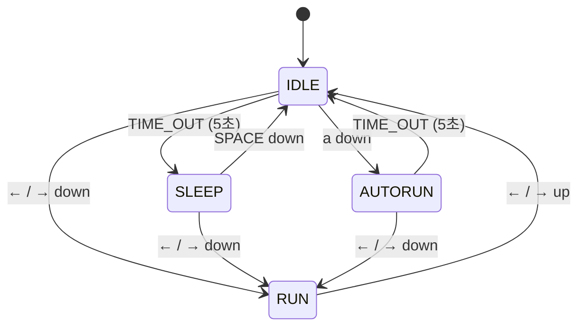

# DRILL11 - AutoRun(자동 무적 런) 상태 구현 계획

## 1. 요구사항

| # | 요구사항 |
|---|---|
| R1 | IDLE 상태에서 `a` 키를 누르면 **AutoRun(자동 무적 런)** 상태로 전이 |
| R2 | AutoRun 상태에서는 키 조작 없이 계속 좌우로 이동 |
| R3 | AutoRun 상태에서는 속도가 빨라지고 크기가 확대됨 |
| R4 | 화면 좌우측 끝에 닿으면 자동으로 방향 전환 |
| R5 | AutoRun 진입 후 5초 이상 경과하면 IDLE 로 복귀 |
| R6 | AutoRun 중 방향키가 눌리면 무적 런 취소 → 눌린 방향으로 움직이는 원래의 RUN 상태로 전이 |
| **필수** | **AutoRun 상태는 반드시 별도의 클래스로 구현** |
| **필수** | **상태 다이어그램을 이미지 파일로 저장소에 포함** |

## 2. 현재 코드 분석 (`DRILL11_AutoRun/`)

- `main.py` : 게임 루프, 이벤트를 `boy.handle_event()` 로 전달
- `grass.py` : 배경 잔디
- `boy.py` : `transitions` 라이브러리의 `Machine` 으로 상태를 **문자열**(`'IDLE'`, `'SLEEP'`, `'RUN'`)로 관리
  - `update()` / `draw()` 안에서 `if self.state == ...` 분기로 상태별 동작 처리
- `boy_game.py` : 초기 단일 파일 버전 (참고용)

→ 상태가 클래스가 아니라 문자열이므로, **"AutoRun 상태 클래스 추가"** 요건을 만족하려면
먼저 기존 상태들을 클래스로 분리하는 리팩터링이 필요하다.

## 3. 설계

### 3.1 구조

```
DRILL11_AutoRun/
├── main.py                # 게임 루프 (거의 변경 없음)
├── grass.py
├── state_machine.py       # [신규] 이벤트 판별 함수 + StateMachine 클래스
├── boy.py                 # Boy + 상태 클래스(Idle, Sleep, Run, AutoRun)
└── make_state_diagram.py  # [신규] 상태 다이어그램 생성 스크립트
state_diagram.png          # [신규] 상태 다이어그램 (제출물, 저장소 루트)
```

### 3.2 상태 클래스 인터페이스

모든 상태 클래스는 같은 인터페이스를 가진다. (`boy` 객체를 인자로 받음)

```python
class AutoRun:
    def __init__(self, boy): self.boy = boy
    def enter(self, e): ...   # 상태 진입 시 1회
    def exit(self, e): ...    # 상태 탈출 시 1회
    def do(self): ...         # 매 프레임 (update)
    def draw(self): ...       # 매 프레임 (draw)
```

### 3.3 이벤트 판별 함수 (`state_machine.py`)

`e = ('INPUT', sdl_event)` 또는 `('TIME_OUT', 0)` 형태의 튜플을 받아 True/False 반환

| 함수 | 의미 |
|---|---|
| `space_down(e)` | SPACE 누름 |
| `time_out(e)` | 상태 타이머 만료 |
| `right_down / right_up` | → 누름 / 뗌 |
| `left_down / left_up` | ← 누름 / 뗌 |
| `a_down(e)` | **`a` 키 누름 (신규)** |

### 3.4 상태 전이표

| 현재 상태 | 이벤트 | 다음 상태 | 비고 |
|---|---|---|---|
| IDLE | `time_out` (5초) | SLEEP | 기존 |
| IDLE | 방향키 down | RUN | 기존 |
| IDLE | **`a_down`** | **AUTORUN** | **신규** |
| SLEEP | `space_down` | IDLE | 기존 |
| SLEEP | 방향키 down | RUN | 기존 |
| RUN | 방향키 up (다른 방향키도 안 눌림) | IDLE | 기존 |
| **AUTORUN** | **`time_out` (5초)** | **IDLE** | **신규** |
| **AUTORUN** | **방향키 down** | **RUN** (눌린 방향) | **신규** |

### 3.5 AutoRun 상세 동작

| 항목 | 값 / 방법 |
|---|---|
| 진입 방향 | 현재 `face_dir` 방향으로 출발 |
| 속도 | `AUTO_RUN_SPEED = SPEED * 2` (= 20) |
| 크기 | `AUTO_RUN_SCALE = 2` → `clip_draw(..., w=200, h=200)`, 발이 땅에 붙도록 `y` 보정 |
| 경계 | 확대된 폭 기준 `MIN_X / MAX_X` 계산, 닿으면 `dir *= -1`, `face_dir` 갱신 |
| 지속 시간 | `enter` 에서 `start_time = get_time()`, `do` 에서 5초 경과 시 `TIME_OUT` 이벤트 발생 |
| 취소 | 방향키 down → RUN 으로 전이, RUN.enter 에서 눌린 키 기준으로 `dir` 결정 |

> RUN 전이 시 방향이 정확하도록 `left_held / right_held` 플래그는 기존처럼 Boy 에서 유지한다.

## 4. 커밋 계획 (총 20개)

커밋 메시지 형식: `태그: 내용` (한국어)
태그 - `설정` / `문서` / `리팩터` / `기능` / `수정`

### 1단계 - 저장소 준비 (1~3)

| # | 커밋 메시지 | 변경 파일 | 내용 |
|---|---|---|---|
| 1 | `설정: 파이썬/파이참용 .gitignore 추가` | `.gitignore` | 캐시, IDE 파일 제외 |
| 2 | `설정: DRILL11 기본 소스 및 리소스 추가` | `DRILL11_file/*` | 현재 상태 그대로(IDLE/SLEEP/RUN) 커밋 |
| 3 | `문서: AutoRun 구현 계획 문서 추가` | `AUTORUN_IMPLEMENTATION_PLAN.md` | 본 문서 |

### 2단계 - 상태 클래스 구조로 리팩터링 (4~10)

| # | 커밋 메시지 | 변경 파일 | 내용 |
|---|---|---|---|
| 4 | `리팩터: 키 이벤트 판별 함수 추가` | `state_machine.py` | `space_down`, `right_down` 등 판별 함수 작성 |
| 5 | `리팩터: StateMachine 클래스 뼈대 작성` | `state_machine.py` | `start / update / draw / handle_event`, 전이표(dict) 기반 전이 |
| 6 | `리팩터: Idle 상태 클래스 분리` | `boy.py` | IDLE 의 enter(타이머 시작)/do/draw 를 클래스로 이동 |
| 7 | `리팩터: Sleep 상태 클래스 분리` | `boy.py` | 눕혀 그리기 로직 이동 |
| 8 | `리팩터: Run 상태 클래스 분리` | `boy.py` | 이동/경계 처리 및 방향 결정 로직 이동 |
| 9 | `리팩터: Boy를 StateMachine 기반으로 전환` | `boy.py` | `transitions` 제거, 전이표 등록, `update/draw/handle_event` 위임 |
| 10 | `수정: Idle 타임아웃을 TIME_OUT 이벤트로 처리` | `boy.py`, `state_machine.py` | 상태 내부에서 이벤트를 발생시키는 방식 정리 (AutoRun 에서도 재사용) |

> 10번까지 끝나면 **기존 동작(IDLE/SLEEP/RUN)이 리팩터링 전과 동일한지 실행 확인**

### 3단계 - AutoRun 구현 (11~18)

| # | 커밋 메시지 | 변경 파일 | 내용 |
|---|---|---|---|
| 11 | `기능: a 키 입력 판별 함수 a_down 추가` | `state_machine.py` | `SDLK_a` 판별 |
| 12 | `기능: AutoRun 상태 클래스 추가` | `boy.py` | enter/exit/do/draw 빈 메서드 뼈대 |
| 13 | `기능: IDLE에서 a 키로 AutoRun 전이 추가` | `boy.py` | 전이표에 `Idle: {a_down: AutoRun}` 등록 (R1) |
| 14 | `기능: AutoRun 자동 이동 및 속도 증가 구현` | `boy.py` | `enter` 에서 방향 설정, `do` 에서 `AUTO_RUN_SPEED` 로 이동 (R2, R3-속도) |
| 15 | `기능: AutoRun 화면 끝 자동 방향 전환 구현` | `boy.py` | 좌우 경계 도달 시 `dir`, `face_dir` 반전 (R4) |
| 16 | `기능: AutoRun 캐릭터 크기 확대 구현` | `boy.py` | 2배 크기로 그리기 + y 보정, 확대 폭 기준 경계 (R3-크기) |
| 17 | `기능: AutoRun 5초 경과 시 IDLE 복귀 구현` | `boy.py` | `start_time` 기록 → 5초 후 `TIME_OUT` → Idle (R5) |
| 18 | `기능: AutoRun 중 방향키 입력 시 RUN 전이 구현` | `boy.py` | `AutoRun: {right_down/left_down: Run}`, 눌린 방향으로 이동 (R6) |

### 4단계 - 제출물 정리 (19~20)

| # | 커밋 메시지 | 변경 파일 | 내용 |
|---|---|---|---|
| 19 | `문서: 상태 다이어그램 이미지 추가` | `state_diagram.png` (+ 원본 소스) | IDLE / SLEEP / RUN / AUTORUN 및 전이 이벤트 표기 |
| 20 | `문서: README 작성 및 구현 내용 정리` | `README.md` | 실행 방법, 조작키, 상태 설명, 다이어그램 이미지 링크 |

## 5. 상태 다이어그램 (초안)



19번 커밋에서 위 내용을 PNG 이미지로 만들어 `state_diagram.png` 로 저장한다.

## 6. 최종 확인 체크리스트

- [ ] IDLE 에서 `a` → 자동으로 좌우 이동 시작 (R1, R2)
- [ ] 이동 속도가 RUN 보다 빠름, 캐릭터가 확대되어 보임 (R3)
- [ ] 화면 양 끝에서 자동으로 방향 전환, 화면 밖으로 나가지 않음 (R4)
- [ ] 5초 후 IDLE 로 복귀, 원래 크기로 돌아옴 (R5)
- [ ] AutoRun 중 ← / → 누르면 해당 방향으로 일반 RUN, 키 떼면 IDLE (R6)
- [ ] SLEEP / RUN 상태에서 `a` 는 무시됨
- [ ] 기존 IDLE ↔ SLEEP ↔ RUN 동작이 그대로 유지됨
- [ ] `AutoRun` 클래스가 코드에 존재
- [ ] `state_diagram.png` 가 저장소에 포함됨
