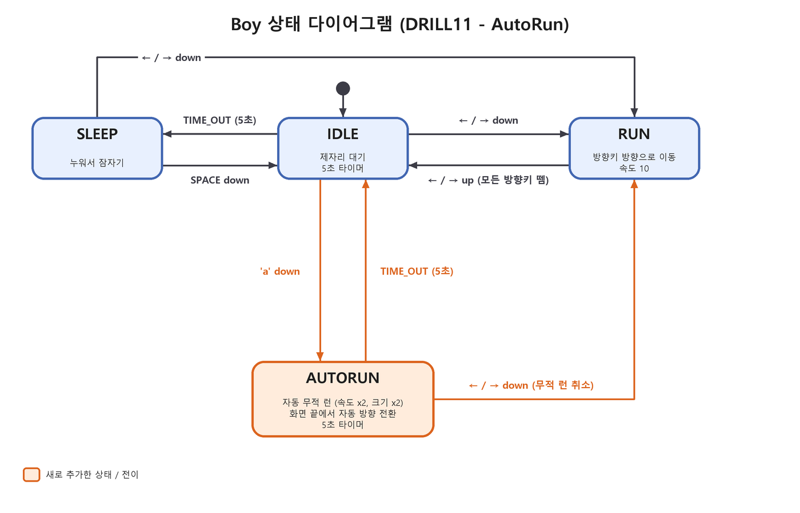

# DRILL11 - AutoRun(자동 무적 런) 상태 추가

pico2d 로 만든 소년(Boy) 캐릭터에 **AutoRun(자동 무적 런)** 상태를 추가한 과제입니다.
상태는 모두 클래스(`Idle`, `Sleep`, `Run`, `AutoRun`)로 구현하고, 전이표 기반 `StateMachine` 으로 관리합니다.

## 실행 방법

```bash
pip install pico2d
cd DRILL11_AutoRun
python main.py
```

## 조작키

| 키 | 동작 |
|---|---|
| ← / → | 해당 방향으로 달리기 (RUN) |
| SPACE | 잠자는 중(SLEEP)일 때 깨우기 |
| a | 서 있을 때(IDLE) 자동 무적 런(AUTORUN) 시작 |
| ESC | 종료 |

## 상태 설명

| 상태 | 설명 |
|---|---|
| IDLE | 제자리 대기. 5초 동안 입력이 없으면 SLEEP |
| SLEEP | 누워서 잠자기. SPACE 로 IDLE, 방향키로 RUN |
| RUN | 누른 방향으로 이동. 방향키를 모두 떼면 IDLE |
| **AUTORUN** | 키 조작 없이 좌우로 계속 이동. **속도 2배, 크기 2배**, 화면 끝에서 자동 방향 전환. **5초 후 IDLE**, 방향키를 누르면 그 방향으로 **RUN** |

## 상태 다이어그램



다이어그램은 `DRILL11_AutoRun/make_state_diagram.py` 로 다시 만들 수 있습니다. (Pillow 필요)

## 파일 구성

```
DRILL11_AutoRun/
├── main.py                # 게임 루프
├── boy.py                 # Boy 와 상태 클래스(Idle, Sleep, Run, AutoRun)
├── state_machine.py       # 이벤트 판별 함수와 StateMachine
├── grass.py               # 배경 잔디
└── make_state_diagram.py  # 상태 다이어그램 생성 스크립트
state_diagram.png          # 상태 다이어그램
PRD.md                     # 구현 계획 문서
```
